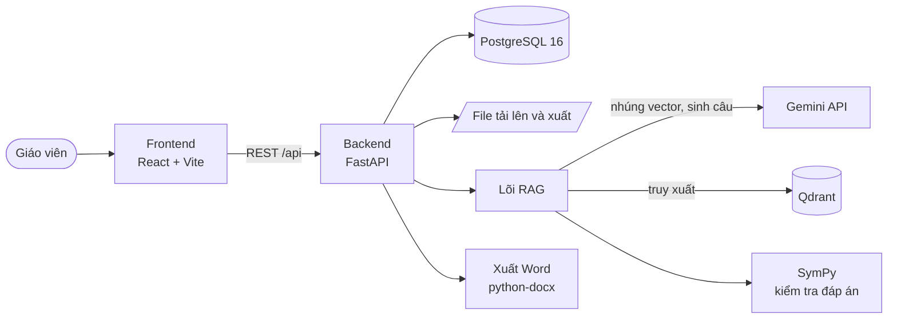
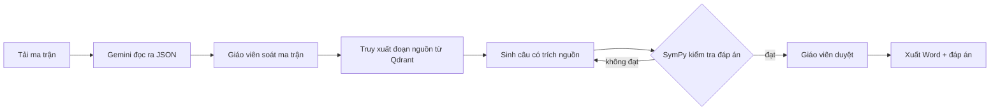

<div align="center">

# EduGenAI

**Trợ lý AI giúp giáo viên THPT tạo đề và chấm bài theo đúng định dạng của Bộ GD&ĐT.**

Tải ma trận đề → AI sinh câu hỏi có trích nguồn → máy kiểm tra đáp án → giáo viên duyệt → xuất Word.

[Chạy thử](#chạy-thử-trong-5-phút) · [Kiến trúc](#kiến-trúc) · [Cấu hình](#cấu-hình) · [Kiểm thử](#kiểm-thử) · [Triển khai](#triển-khai) · [Đóng góp](#đóng-góp)

</div>

*EduGenAI helps Vietnamese high-school teachers generate and grade exams (Math, Physics, Chemistry, Biology) in the official Ministry of Education format, with every question traced to a source and every numeric answer verified by a computer algebra system.*

---

## Vì sao có EduGenAI

Ra một đề kiểm tra đúng ma trận mất hàng giờ: chọn chủ đề, cân mức độ nhận thức, viết từng câu, tự giải lại để chắc đáp án đúng. Các công cụ AI chung chung thì hay bịa số liệu, sai kiến thức và không nói được câu hỏi lấy từ đâu.

EduGenAI giải quyết ba việc đó:

| Vấn đề của giáo viên | Cách EduGenAI xử lý |
|---|---|
| Đề phải bám đúng ma trận (chủ đề, mức độ, số câu, cấu trúc đề) | Đọc ma trận từ file ảnh hoặc PDF, cho giáo viên soát lại từng ô trước khi sinh |
| Sợ AI bịa kiến thức | Sinh câu bằng **RAG**: mỗi câu trích dẫn đoạn SGK hoặc đề tham khảo mà nó dựa vào |
| Sợ đáp án sai | Đáp án số được **SymPy** kiểm tra độc lập, câu không qua kiểm tra bị loại hoặc gắn cờ |

## Tính năng

**Khối 1: Sinh đề**
- Nạp tài liệu nguồn (SGK, đề tham khảo): chia đoạn, nhúng vector, lưu vào Qdrant.
- Đọc ma trận đề bằng Gemini ra JSON có cấu trúc, tự đọc lại khi tổng điểm lệch. Kết quả được lưu theo mã băm của file, nên tải lại đúng file đó thì không tốn token.
- Sinh câu hỏi theo từng ô của ma trận: trắc nghiệm, Đúng–Sai, trả lời ngắn, công thức LaTeX.
- Hình khối không gian: mô hình trả kích thước, backend vẽ SVG, DOCX nhúng ảnh PNG.
- Rào chắn nội dung, kiểm tra cấu trúc đề, trích nguồn cho từng câu.
- Giáo viên duyệt và sửa từng câu, nhiều mã đề, ngân hàng câu hỏi, xuất đề và đáp án ra Word.

**Khối 2: Chấm bài và học lại** *(đang phát triển)*
- Quản lý lớp, học sinh; phiếu trả lời đọc được bằng máy; chấm bằng scan/OCR; kết quả và gợi ý ôn tập.

**Nền tảng**
- Đăng nhập JWT, phân quyền theo trường, chống dò mật khẩu, giới hạn dung lượng tải lên.
- Chạy được bằng một lệnh Docker, có CI và tự triển khai lên máy chủ.

> **Về môn học:** Toán là môn được làm đầy đủ nhất. Lý và Hóa đã có trong danh mục môn của hệ thống; Sinh dự kiến theo sau. Thêm môn chủ yếu là thêm dữ liệu (chủ đề, nguồn RAG), không viết lại luồng xử lý.

## Kiến trúc



Luồng sinh một đề:



### Cấu trúc thư mục

| Thư mục | Nội dung |
|---|---|
| `edugen-backend/` | Backend FastAPI. `app/api/v1` (đường dẫn API), `app/domain` (luật nghiệp vụ thuần: ma trận, cấu trúc đề, câu hỏi), `app/rag` (chia đoạn, nhúng, truy xuất, sinh câu, kiểm tra), `app/services` (xuất DOCX, đọc ma trận, ngân hàng câu hỏi), `alembic/` (migration), `tests/` |
| `frontend/` | Giao diện React 19, TypeScript, Tailwind CSS 4, kiểm thử E2E bằng Playwright. Xem `frontend/DESIGN.md` |
| `deploy/` | Docker Compose cho production, Caddy (HTTPS tự động), script sao lưu. Xem `deploy/README.md` |
| `.github/workflows/` | CI: commitlint, test backend và frontend, kiểm tra migration, build image, tự triển khai |

### Công nghệ

| Lớp | Công nghệ |
|---|---|
| Backend | Python 3.12, FastAPI, SQLAlchemy 2, Alembic, Pydantic, PyJWT |
| AI / RAG | Gemini (sinh câu, đọc ảnh, nhúng), Qdrant, SymPy, PyMuPDF; tùy chọn Anthropic hoặc bộ nhúng bge-m3 |
| Dữ liệu | PostgreSQL 16 |
| Xuất tài liệu | python-docx, CairoSVG (hình khối) |
| Frontend | React 19, Vite 7, TypeScript, Tailwind CSS 4, Playwright |
| Hạ tầng | Docker Compose, Caddy, GitHub Actions, GHCR, Google Compute Engine |

## Chạy thử trong 5 phút

**Cần có:** Docker và Docker Compose. Muốn sinh câu bằng RAG thật thì cần thêm khóa Gemini và một Qdrant đã nạp dữ liệu.

```bash
git clone <địa-chỉ-repo> edugenai
cd edugenai
cp edugen-backend/.env.example edugen-backend/.env   # điền GEMINI_API_KEY, QDRANT_URL, QDRANT_API_KEY
docker compose up --build
```

Sau khi chạy xong:
- Giao diện: <http://localhost:5173>
- API và tài liệu Swagger: <http://localhost:8000/docs>

Hệ thống không có API tạo trường, nên tài khoản quản trị đầu tiên được tạo bằng lệnh seed (xem tham số trong `edugen-backend/app/seed.py`):

```bash
docker compose exec backend python -m app.seed \
  --school-code demo --school-name "THPT Demo" \
  --admin-email admin@demo.vn --admin-name "Quản trị" \
  --admin-password '<mật-khẩu-của-bạn>'
```

> Không có `QDRANT_URL` thì backend dùng chỉ mục nhúng cục bộ trong `edugen-backend/qdrant_data/`. Thư mục này không đi kèm repo, nên muốn sinh câu bằng RAG thật bạn cần trỏ tới một Qdrant đã nạp dữ liệu, hoặc tự nạp nguồn.

### Thử giao diện mà không cần khóa API

Backend có chế độ phát triển với RAG giả lập, không cần Gemini hay Qdrant:

```bash
cd edugen-backend
uv sync
uv run python scripts/dev_server.py
```

```bash
cd frontend
npm ci
npm run dev        # http://localhost:5173
```

## Cấu hình

Mọi biến nằm trong `edugen-backend/.env` (mẫu: `.env.example`). Các biến chính:

| Biến | Ý nghĩa | Mặc định |
|---|---|---|
| `GEMINI_API_KEY` | Khóa Gemini cho sinh câu, đọc ma trận, nhúng | trống |
| `LLM_PROVIDER` | `gemini` hoặc `anthropic` | `gemini` |
| `GEMINI_MODEL` | Mô hình sinh câu | xem `.env.example` |
| `GEMINI_THINKING` | Mức suy luận: `minimal` / `low` / `medium` / `high` | `medium` |
| `EMBEDDER` | `gemini` hoặc `bge-m3` | `gemini` |
| `QDRANT_URL`, `QDRANT_API_KEY` | Qdrant Cloud/server; trống thì dùng chỉ mục cục bộ | trống |
| `DATABASE_URL` | Chuỗi kết nối PostgreSQL | mặc định dev |
| `APP_ENV` | Khác `dev` thì **bắt buộc** có `JWT_SECRET` từ 32 ký tự | `dev` |
| `MATRIX_CACHE_ENABLED` | Lưu kết quả đọc ma trận để tải lại không gọi Gemini | `true` |
| `MAX_UPLOAD_MB` | Giới hạn dung lượng tải lên | `20` |
| `RAG_MOCK_SAMPLES` | Dùng RAG giả lập từ file mẫu | trống (RAG thật) |

> **Bảo mật:** không commit file `.env`. Repo đã bỏ qua nó trong `.gitignore`.

## Kiểm thử

Dự án phát triển theo **TDD**: không viết code production khi chưa có một test đỏ đòi hỏi nó.

```bash
cd edugen-backend
uv run pytest                    # unit + API, không gọi dịch vụ trả phí
uv run pytest -m acceptance      # kiểm thử chấp nhận cả luồng
uv run pytest -m eval            # đánh giá chất lượng mô hình trên bộ vàng (tốn thời gian và tiền)
uv run ruff check
```

```bash
cd frontend
npx playwright test              # E2E, cần backend dev đang chạy
```

Thứ tự chạy theo chi phí, **từ rẻ lên đắt**, và dừng ngay khi tầng rẻ đã đỏ: test thuần và test dùng đối tượng giả → truy xuất Qdrant cục bộ → đánh giá recall chỉ truy xuất → gọi Gemini thật trên vài ô mẫu. Mặc định `pytest` bỏ qua `acceptance` và `eval` để không vô tình tốn hạn mức API.

## Triển khai

Một máy ảo chạy toàn bộ bằng Docker Compose; Caddy lo HTTPS và là dịch vụ duy nhất mở cổng.

- Mỗi pull request được CI build image. Push lên `main` thì đẩy image lên GHCR, sao lưu CSDL, triển khai bản mới và kiểm tra `/health`.
- Cài đặt máy chủ, tên miền, sao lưu và khôi phục: xem [`deploy/README.md`](deploy/README.md).

## Nguyên tắc thiết kế

1. **Mọi đáp án số đều được SymPy kiểm tra**, và có test cho việc đó.
2. **Mọi câu sinh ra đều trích nguồn**, và có test cho việc đó.
3. **Cấu trúc đề và cách tính điểm theo định dạng chính thức của Bộ GD&ĐT.**
4. **Giáo viên luôn là người duyệt cuối.** AI đề xuất, không tự phát hành.
5. **Thêm môn là thêm dữ liệu**, không viết lại luồng.

## Đóng góp

Xem [CONTRIBUTING.md](CONTRIBUTING.md). Tóm tắt:
- Commit theo [Conventional Commits](https://www.conventionalcommits.org/); commit test trước, commit code sau.
- Mỗi thay đổi gắn với một GitHub Issue.
- Viết test trước code (TDD).

## Nhóm thực hiện

Hackathon 2026, nhóm 4 người: Minh Quan (trưởng nhóm, RAG), Huy Tran (backend), Phu Thanh (backend), Dong Quan (RAG).
